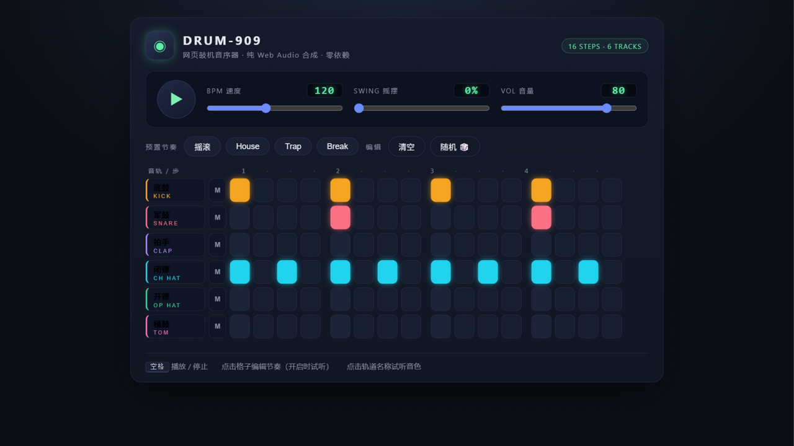

# 🥁 DRUM-909 · 网页鼓机音序器

> 纯 Web Audio 实时合成 · 单文件 · 零依赖 —— 打开即玩

[](https://duyv0826.github.io/drum-machine/)
[](LICENSE)
[](#本地运行)



**在线试玩：https://duyv0826.github.io/drum-machine/**

## 特性

- **6 轨 × 16 步音序器** — 底鼓、军鼓、拍手、闭镲、开镲、桶鼓，每轨独立配色、独立静音
- **纯合成音色** — 全部鼓声由 Web Audio API 实时合成（正弦音高包络、噪声滤波、方波金属簇），不加载任何采样文件
- **精确时序** — lookahead 调度器（25ms 轮询 + 120ms 提前量），不随定时器漂移；Swing 摇摆可调 0–60%
- **4 组预置节奏** — 摇滚 / House / Trap / Breakbeat，一键切换并自动匹配速度
- **随机生成** — 按乐理概率（而非纯乱数）生成节奏，用来找灵感
- 播放走带列高亮、格子触发闪光、空格键播放/停止、点击格子即开即听

## 玩法

| 操作 | 方式 |
|---|---|
| 播放 / 停止 | 点击播放按钮或按 <kbd>空格</kbd> |
| 编辑节奏 | 点击格子开启/关闭（开启时自动试听） |
| 试听音色 | 点击左侧轨道名称 |
| 静音轨道 | 点击轨道右侧 `M` 按钮 |
| 调节 | BPM（60–200）、Swing、主音量 |

## 本地运行

无需构建，任选其一：

```bash
# 方式一：直接双击 index.html 用浏览器打开

# 方式二：起本地服务
python -m http.server 8080
# 然后访问 http://localhost:8080
```

## 技术实现

- **音色引擎**：每种鼓 = 振荡器 + 增益包络 +（部分）缓冲噪声过滤波器的组合。例如底鼓为正弦波 160Hz→42Hz 音高下滑 + 高通噪声 click；闭/开镲为 6 个固定比率方波簇过 8kHz 高通，仅衰减时长不同
- **调度器**：经典 Web Audio lookahead 模式，音频时钟（`ctx.currentTime`）驱动事件排程，UI 走带通过事件队列同步，双向各不漂移
- **主链路**：master gain → DynamicsCompressor（-14dB/4:1）→ 输出，防爆音

单文件 `index.html`（约 580 行），无任何外部依赖。

## License

[MIT](LICENSE)
